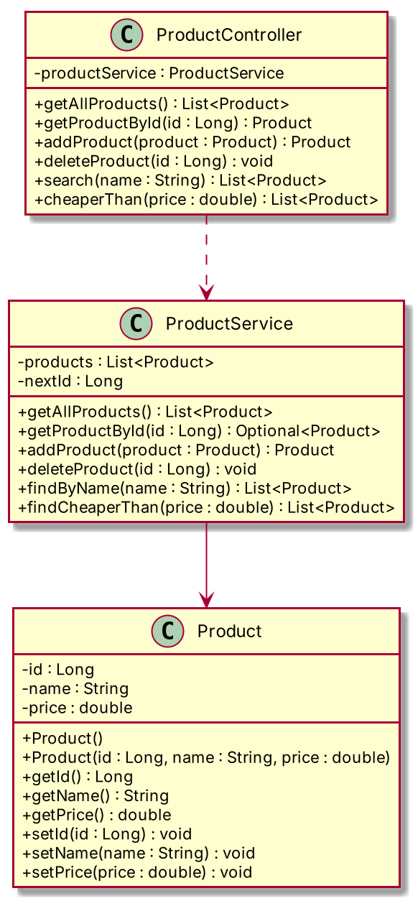
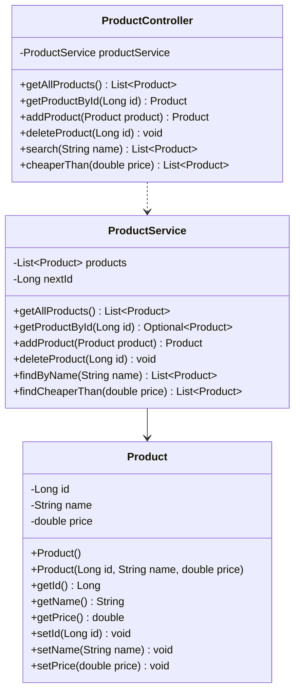

# Product, ProductService and ProductController — UML Class Diagram (Tutorial 3)

- `ProductController ..> ProductService` — **dependency** (dashed line, open arrow). The controller uses the service.
- `ProductService --> Product` — **association** (solid line). The service holds a `List<Product>`.
- Every arrow leaves the controller; nothing points back up to it.

Source: [`Product.puml`](Product.puml)

